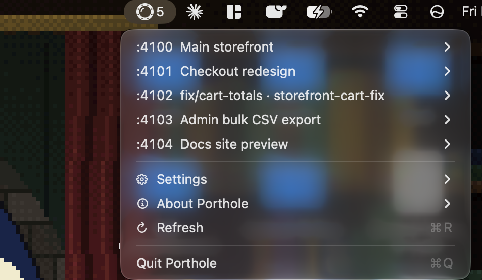
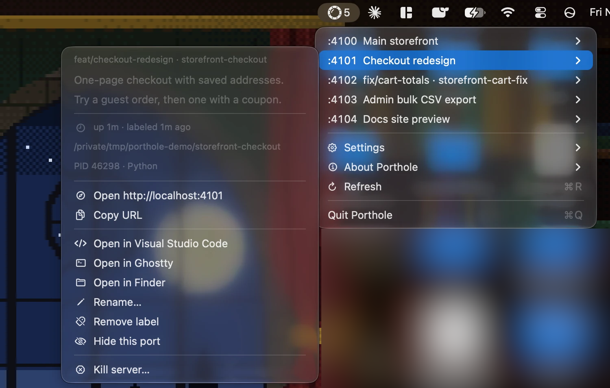

# Porthole

**Which feature is running on which localhost port**, right in your macOS menu bar, labeled by your coding agent.

When you have three checkouts, two worktrees and a Docker stack all serving something on `localhost`, it's hard to remember that `:4100` is your main storefront and `:4102` is yesterday's cart-totals fix. Porthole gives every port a name. Your agent (Claude Code, Codex, Cursor or any MCP client) labels the dev server it just started, and the menu shows the label next to the port with its branch, folder and uptime.

<p align="center">
  
</p>

## Features

- **Labels from your agent.** After starting a dev server, the agent calls `register_server(port, title, description?)`. Porthole detects the branch and folder itself.
- **Every listening port, labeled or not.** Ports in 3000–9999 show up even if nobody labeled them, named by `branch · folder` (like `:4102` above). System processes and database ports are filtered out.
- **One click to open it.** Click a row to open it in Chrome (or your browser of choice). Hover it for the details and actions.
- **Jump to the code.** Open the checkout in your editor, a terminal or Finder, at the git root (or the compose project folder for Docker).
- **Docker-aware.** Published container ports are named by compose project · service, and get **Stop container…** (`docker stop` for just that container) instead of Kill.
- **No port collisions between agents.** `suggest_free_port` hands out ports that nothing is listening on and no label claims. It reserves them for 2 minutes, so two agents working in parallel never get the same one.
- **Stays current by itself.** A server shows up or disappears within ~5 s. If a different checkout takes over a labeled port, the old label is set aside. Labels for ports that stay dead for 24 h are pruned.

<p align="center">
  
</p>

Each port's submenu shows the branch, uptime, label age, folder and PID, and these actions:

- Open and Copy URL
- Open in your editor, terminal or Finder
- Rename… or Label this port…
- Remove label
- Hide this port
- Kill server… (asks first)

## Install

Requires macOS, Node 20+ and [SwiftBar](https://swiftbar.app).

```bash
brew install --cask swiftbar          # launch it once and pick a plugin folder
git clone https://github.com/GregGlickert/porthole.git && cd porthole
./scripts/install.sh
```

`install.sh` is safe to re-run. It installs dependencies, a launcher at `~/.porthole/bin/porthole`, and the SwiftBar plugin.

The launcher finds node each time it runs (your nvm default, `PATH`, Volta or Homebrew), so switching or removing node versions doesn't break the menu or your MCP config. To force a specific node, set `PORTHOLE_NODE=/path/to/node`.

## Connect your agent

Every client runs the same stdio server: `~/.porthole/bin/porthole mcp`. Use the full path (`install.sh` prints it), because most clients don't expand `~`.

**Claude Code**
```bash
claude mcp add porthole -s user -- ~/.porthole/bin/porthole mcp
```

**Codex**
```bash
codex mcp add porthole -- ~/.porthole/bin/porthole mcp
```
(or add `[mcp_servers.porthole]` with `command = "/Users/you/.porthole/bin/porthole"` and `args = ["mcp"]` to `~/.codex/config.toml`)

**Cursor** (`~/.cursor/mcp.json`), **Claude Desktop** (`~/Library/Application Support/Claude/claude_desktop_config.json`), **Windsurf** (`~/.codeium/windsurf/mcp_config.json`):
```json
{
  "mcpServers": {
    "porthole": { "command": "/Users/you/.porthole/bin/porthole", "args": ["mcp"] }
  }
}
```

**VS Code** (`.vscode/mcp.json`, or the user-level MCP config):
```json
{
  "servers": {
    "porthole": { "type": "stdio", "command": "/Users/you/.porthole/bin/porthole", "args": ["mcp"] }
  }
}
```

The server already tells agents when to use it. For clients that ignore server instructions, add this to your agent rules (`~/.claude/CLAUDE.md`, `AGENTS.md`, Cursor rules, …):

> When you start a local dev server (or the user says one is running), call the porthole `register_server` tool with its port and a ≤8-word title describing the feature/branch being tested. Call `suggest_free_port` before picking a port. Update or remove the label when that changes.

### MCP tools

| Tool | What it does |
|---|---|
| `register_server(port, title, description?)` | Label a running server. Waits up to 10 s for the port to start listening. |
| `update_server(port, title?, description?)` | Change a label. |
| `remove_server(port)` | Clear a label (doesn't stop the server). |
| `list_servers(port?)` | Every listening dev server with its label, branch, folder, uptime and Docker info. |
| `suggest_free_port(preferred?, count?)` | Free ports, reserved for 2 minutes. |

## CLI

```
porthole list | register <port> <title> [desc] | remove <port> | open <port> | copy <port> | kill <port>
         | confirm-kill <port> | prompt-label <port> | ignore/unignore <port|command> | ignored | edit | swiftbar
```
(Add `~/.porthole/bin` to your `PATH` to get the `porthole` command, or run `node src/cli.js …`.)

## Settings

### Hiding ports

Use **Hide this port** in a port's submenu, or the CLI:

```bash
porthole ignore 8000             # hide a port
porthole ignore claude-science   # hide every port owned by a process name
porthole unignore 8000
porthole ignored                 # show the list
```

Hidden items are listed under **Settings** in the menu. Click one to show it again.

### Config file

Settings live in `~/.porthole/config.json`. Open it with **Settings → Open config file…** or `porthole edit`:

```json
{
  "ignorePorts": [8000],
  "ignoreCommands": ["claude-science"],
  "portMin": 3000,
  "portMax": 9999,
  "editor": "Zed",
  "terminal": "iTerm",
  "browser": "Arc"
}
```

`editor`, `terminal` and `browser` are optional:

- **Editor:** without one set, "Open in …" uses the first installed of Cursor, Visual Studio Code, Zed, Windsurf and Sublime Text.
- **Terminal:** without one set, it uses the first installed of Ghostty, iTerm, Warp and Terminal.
- **Browser:** without one set, ports open in Google Chrome if it's installed, otherwise in your default browser.

### Environment variables

`PORTHOLE_HOME` (default `~/.porthole`), `PORTHOLE_PORT_MIN` / `PORTHOLE_PORT_MAX` (default 3000–9999; `portMin` / `portMax` in config.json override these).

## How it works

- **Labels** live in `~/.porthole/servers.json`. The MCP server, the CLI and the menu all read and write that one file, with atomic writes. There's no daemon to manage.
- **The menu** is a SwiftBar streamable plugin: one background process that SwiftBar starts and stops.
  - Every 5 s it checks the listening ports with `netstat`, which takes ~10 ms.
  - Only when that list changes does it run the full scan: `lsof` for each process's folder, plus `git`, `ps` and `docker`.
  - It watches `~/.porthole/` for edits, so label and setting changes show up right away.
- **Menu clicks** go straight to `open` and `pbcopy` where they can, so opening, copying and "Open in …" don't start node at all.

## Tests

```bash
npm test
```

## License

MIT. See [LICENSE](LICENSE).
